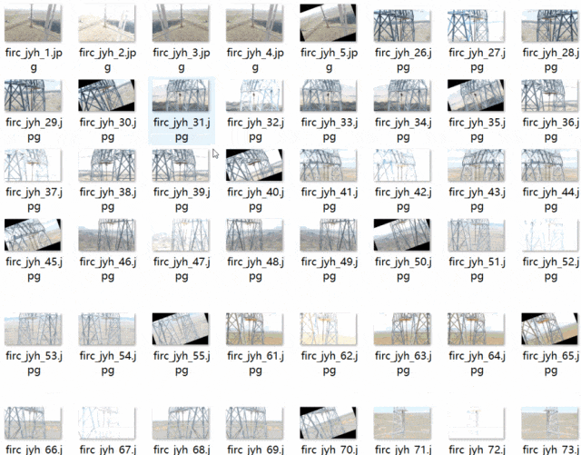
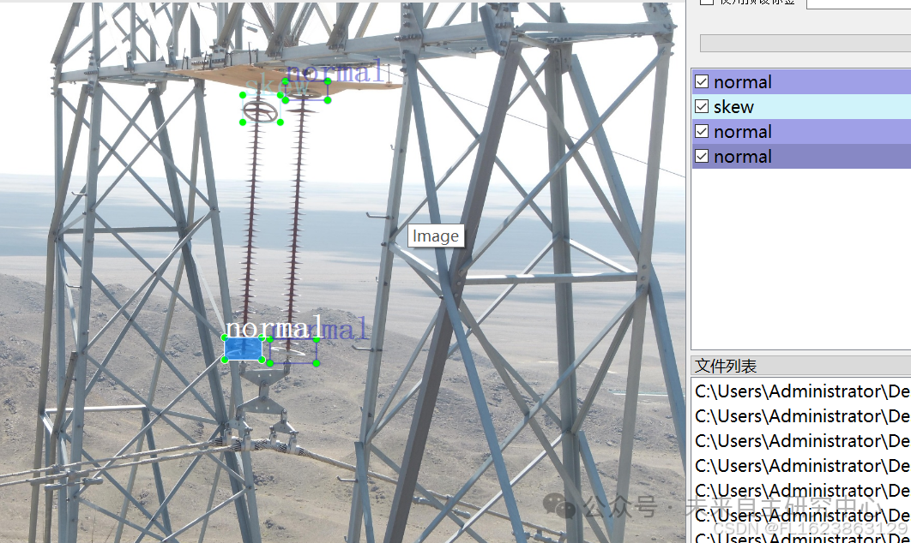

# [Dataset] [Object Detection] Power Scenery Transmission Line Imbalanced Ring Alignment Detection VOC+YOLO format with 303 images in 2 categories

Dataset format: Pascal VOC format + YOLO format (txt file without split path, only containing jpg images and corresponding VOC format xml files and yolo format txt files)
Number of images (number of jpg files): 303
Number of annotations (number of xml files): 303
Number of annotations (number of txt files): 303
Number of annotation categories: 2
Annotation category names: ["normal", "skew"]
Number of bounding boxes per category:
Normal bounding box count = 161
Skew bounding box count = 305
Total bounding box count: 466
Labeling tool used: labelImg
Annotation rules: Draw a rectangle around the category
Important note: If there are enhanced images in the dataset, please carefully review the image preview before downloading.
Special declaration: This dataset does not guarantee the accuracy or weights of the trained models or weight files, only accurate and reasonable annotations are provided.

Image Preview:

Annotation example:

## Payment

Here is a pay link on Stripe ( https://buy.stripe.com/3cs8yP7sY87d0vu9AB ). Please contact me lonlonago@foxmail.com after funding $89, and I will send you a complete data files , thank you!

